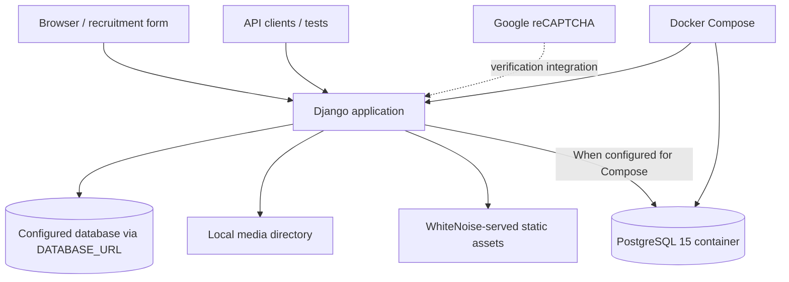

# SmartForm — Architecture, runtime and reproducibility

SmartForm is a Django-based recruitment form application with browser-driven workflows, form validation, uploaded files and a REST interface. The repository includes local Django setup, a Dockerfile, Compose configuration, and documentation of Playwright and Newman tests. This diagram reflects the checked-in code and configuration, **not** evidence of a hardened production deployment.

## Runtime topology

Django settings load the database connection through `DATABASE_URL`. The `docker-compose.yml` file defines `web`, `db`, a persistent PostgreSQL volume, and a development-style bind mount. The image uses `python:3.10-slim`, installs `requirements.txt`, and invokes `entrypoint.sh`. The entrypoint collects static files, runs migrations, initializes a privileged Django account and starts Gunicorn.

The presence of a Dockerfile and Compose configuration does **not** demonstrate an HA deployment, production monitoring or validated disaster recovery.

## Local setup

For a host-based development environment, the root README provides a virtualenv and `python manage.py migrate` / `runserver` sequence. Before running Django, configure the required variables indicated by `SmartForm/settings.py`: `SECRET_KEY`, `DEBUG`, `ALLOWED_HOSTS`, `DATABASE_URL`, `RECAPTCHA_PUBLIC_KEY`, and `RECAPTCHA_PRIVATE_KEY`. Do not commit real values.

For Compose, check `.env` and database connection settings before `docker compose up --build`. The current Compose configuration includes a development-oriented database credential and exposed web port; it is **not a secure production deployment template**.

## Testing

The root README describes Playwright end-to-end flows and Newman API collections. Verify the referenced test paths against the actual tree before using them; documentation alone is not proof that tests passed. No CI validation is asserted in this document.

## Security and publication review — action required

These are observations from checked-in configuration, **not confirmed exploitability or evidence of leaked real customer data**:

1. `docker-compose.yml` embeds a PostgreSQL password. Move the credential to environment/secret management and rotate it if it was reused.
2. `entrypoint.sh` interpolates environment-derived administrative credentials into a `manage.py shell -c` Python expression and resets the superuser password on startup. This deserves a security review for credential handling and predictable administrative privilege setup.
3. `SmartForm/settings.py` enables Django REST Framework BasicAuthentication as well as session authentication; verify HTTPS termination and authentication requirements for any actual deployment.
4. Check whether tracked files include databases, `.env.prod`, `superuser.json`, uploaded documents or dependencies. A `.gitignore` does not remove content already in Git history. **Do not publish real personal records or secrets in an issue or PR.**
5. Keep debug configuration, CAPTCHA keys, allowed hosts and media handling environment-specific.

No files or history are removed by this documentation change. If credentials were ever real and exposed, revoke/rotate them and separately plan repository cleanup after assessing dependencies and backups.

## Scope of evidence

Verified here by static review of `Dockerfile`, `docker-compose.yml`, `entrypoint.sh`, `SmartForm/settings.py`, `.gitignore`, `requirements.txt` and root README. Runtime, security scanning, database restore and end-to-end tests were **not** executed.
