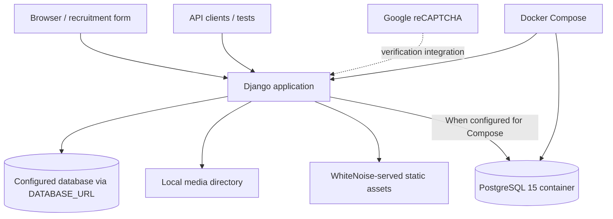

# SmartForm — Architecture, runtime and reproducibility

SmartForm is a Django-based recruitment form application with browser-driven workflows, form validation, uploaded files and a REST interface. The repository includes local Django setup, a Dockerfile, Compose configuration, and documentation of Playwright and Newman tests. This diagram reflects the checked-in code and configuration, **not** evidence of a hardened production deployment.

## Runtime topology

Django settings load the database connection through `DATABASE_URL`. The `docker-compose.yml` file defines `web`, `db`, a persistent PostgreSQL volume, and a development-style bind mount. The image uses `python:3.10-slim`, installs `requirements.txt`, and invokes `entrypoint.sh`. The entrypoint collects static files, runs migrations and starts Gunicorn. Administrator provisioning must be performed explicitly using Django management commands.

The presence of a Dockerfile and Compose configuration does **not** demonstrate an HA deployment, production monitoring or validated disaster recovery.

## Local setup

For a host-based development environment, the root README provides a virtualenv and `python manage.py migrate` / `runserver` sequence. Before running Django, configure the required variables indicated by `SmartForm/settings.py`: `SECRET_KEY`, `DEBUG`, `ALLOWED_HOSTS`, `DATABASE_URL`, `RECAPTCHA_PUBLIC_KEY`, and `RECAPTCHA_PRIVATE_KEY`. Do not commit real values.

For Compose, check `.env` and database connection settings before `docker compose up --build`. The current Compose configuration requires `POSTGRES_PASSWORD` and `DATABASE_URL` supplied in a private `.env`. The example file contains placeholders, not deployable secrets. This development Compose configuration remains **not a hardened production deployment template**.

## Testing

The root README describes Playwright end-to-end flows and Newman API collections. Verify the referenced test paths against the actual tree before using them; documentation alone is not proof that tests passed. No CI validation is asserted in this document.

## Security and publication review — action required

These are observations from checked-in configuration, **not confirmed exploitability or evidence of leaked real customer data**:

1. The hard-coded PostgreSQL password was removed from Compose. Inject a new password via a private `.env` and never reuse the old checked-in value.
2. Automatic superuser creation, elevation and password resets were removed from the entrypoint. Provision admin users deliberately via `python manage.py createsuperuser`.
3. `SmartForm/settings.py` enables Django REST Framework BasicAuthentication as well as session authentication; verify HTTPS termination and authentication requirements for any actual deployment.
4. The tracked `.env.prod`, `superuser.json` and `db.sqlite3` files were removed in the security cleanup. Their **historical Git copies still exist**, potentially exposing a Django secret key, account password hash and personal records. Rotate all potentially exposed credentials and coordinate history remediation if needed. **Do not copy sensitive contents into issues, PRs or logs.**
5. Keep debug configuration, CAPTCHA keys, allowed hosts and media handling environment-specific.

Existing deployments must update environment variables, rotate secrets, and ensure they have a database backup before pulling the removal of a tracked local SQLite database. This change does not rewrite Git history.

## Scope of evidence

Verified here by static review of `Dockerfile`, `docker-compose.yml`, `entrypoint.sh`, `SmartForm/settings.py`, `.gitignore`, `requirements.txt` and root README. Runtime, security scanning, database restore and end-to-end tests were **not** executed.
